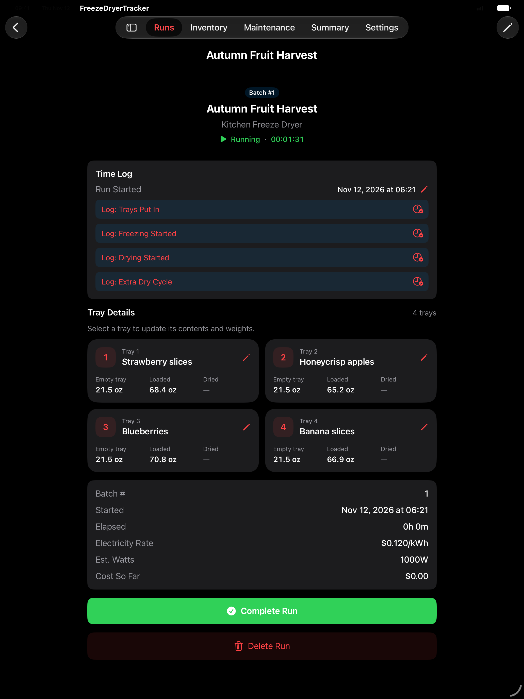
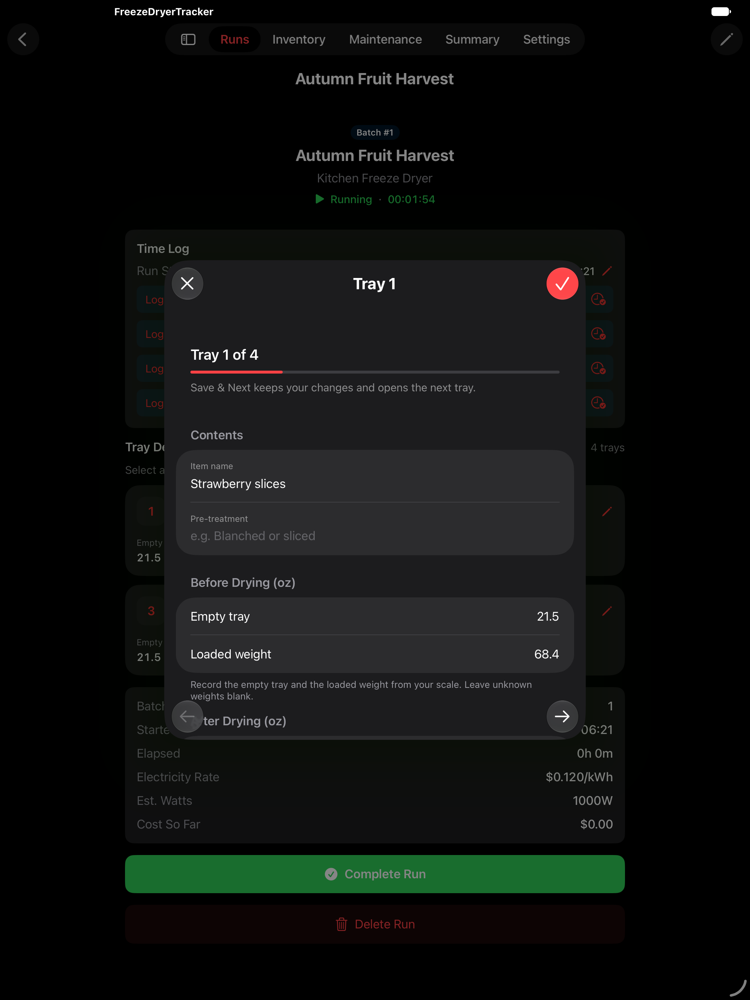
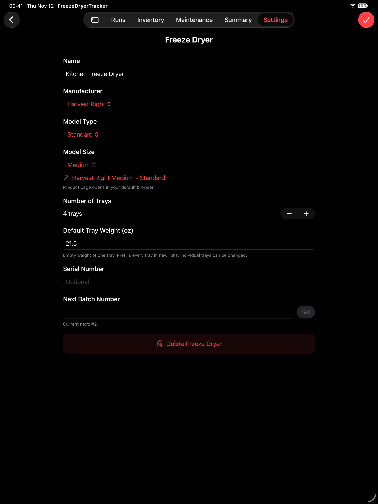

# FreezeDryerTracker

### From the first tray to the pantry shelf.

Keep your freeze-drying routine organized with one place for your dryers, batches, tray measurements, maintenance, and stored food. Remember what worked, follow each run, and find what you put away.

**For iPhone, iPad, and Mac · iCloud sync · Shared family datasets**

[Explore the features](#make-every-batch-easier-to-follow) · [Get started](#your-first-batch-in-three-steps) · [Get help](support.md)

## A closer look

| Follow your batch | Update one tray at a time | Set up your dryer |
| --- | --- | --- |
|  |  |  |

## Make every batch easier to follow

### Give every dryer its own history

Manage one machine or several. Keep manufacturer and model details, tray counts, serial numbers, purchase dates, and pump hours together. Built-in Harvest Right model options link to product pages, and a default empty-tray weight fills new trays for that dryer's runs.

### Keep the details that make a batch repeatable

Log batch numbers, start and finish times, drying stages, extra-dry cycles, and defrosts. Add preparation notes, quality ratings, and error notes so the details are there when you return to a favorite food or troubleshoot a run.

### Work through trays without losing your place

Enter contents, pre-treatment, and empty, loaded, and dried weights for each tray. Update one tray at a time, save, and move straight to the next. Choose grams or ounces to match your workflow.

### Know what is on the shelf

Keep an inventory of packaged food with quantities, container details, oxygen absorbers, storage locations, and estimated best-by dates. Link inventory to its source run so you can trace a stored batch back to your notes.

### Keep maintenance in the record

Record oil changes, filter replacements, chamber cleaning, and other service with dates, notes, and pump hours. Keep the maintenance history beside the machine it belongs to.

### Understand time and estimated cost

Review run duration and estimated electricity costs using your rate and the dryer's estimated wattage. Build a useful record of the time and energy behind your batches.

## Your records, across your Apple devices

Check a run on your iPhone, enter tray measurements on your iPad, or review your records on your Mac. Personal records sync through iCloud between devices using the same Apple Account.

Keep working offline. Changes save on your device and sync when iCloud is available; keep the app open to let pending updates finish.

## A shared notebook for the whole family

Create a family dataset from a copy of your personal records, then invite the people you want to work with. Everyone who joins can view and update the full shared dataset, including dryers, runs, trays, maintenance, inventory, and preferences.

Your personal records stay separate. The owner controls invitations and access, and family members can contribute from their own Apple Accounts on iPhone, iPad, and Mac. Joining uses an iCloud invitation, independently of Apple's purchase-sharing family group.

[Learn how family sharing works →](support.md#how-do-i-share-with-my-family)

## Your first batch in three steps

1. **Add your freeze dryer.** Choose its manufacturer and model, set the tray count, and enter a default empty-tray weight.
2. **Start a run.** Name the batch, fill in each tray, and record times and measurements as you go.
3. **Put it away with a record.** Log packaged food in inventory, add storage details, and keep notes for the next batch.

## Keep a copy you control

Export a backup of your currently open dataset to a file you choose. Restore a saved backup when needed. Personal and family datasets can be backed up separately.

Local use requires no separate app account. iCloud provides synchronization and invitation-based sharing; the app includes no advertising or third-party analytics SDKs.

[Read the privacy policy →](privacy.md)

## Support

Questions, ideas, or a batch-tracking problem? Visit the [support page](support.md) or email [emkinter@me.com](mailto:emkinter@me.com).

Requires iOS 26, iPadOS 26, or macOS 26 or later. iCloud features require an Apple Account and available iCloud storage.

FreezeDryerTracker is a manual logging app. Electricity costs and best-by dates are estimates; follow your manufacturer's instructions and appropriate food-safety guidance.
